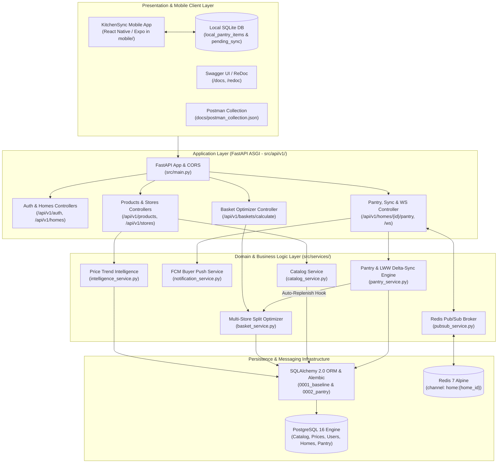

# Smart Basket & KitchenSync 🛒📱

> Real-time grocery price intelligence, multi-store basket optimization, and collaborative household pantry synchronization engine with an offline-first React Native (Expo) mobile client.

[](https://github.com/DyanCoded/Smart-Basket/actions/workflows/ci.yml)
[](https://www.python.org/downloads/)
[](https://fastapi.tiangolo.com)
[](https://www.postgresql.org/)
[](https://redis.io/)
[](https://expo.dev/)
[](docs/RELEASE_NOTES_v2.0.0.md)
[](https://opensource.org/licenses/MIT)

---

## 📌 Project Overview

**Smart Basket** combines a mathematically exact supermarket price comparison engine (**Phase 1**) with **KitchenSync** (**Phase 2**)—a collaborative household pantry management system and cross-platform **React Native (Expo)** mobile app.

Instead of manually rebuilding shopping lists every week and hunting across supermarket flyers, household members track their shared kitchen inventory (`ok`, `low`, `finished`) on their phones—even while offline via a local SQLite mutation queue (`pending_sync`). Whenever a catalog-linked pantry staple runs `low` or `finished`:
1. **Auto-Basket Replenishment:** The item is automatically upserted into the household's active Smart Basket (`basket_items`).
2. **Real-Time Household Sync:** Redis Pub/Sub broadcasts `ITEM_UPDATED` / `ITEM_DELETED` events over WebSockets (`WS /api/v1/homes/{home_id}/ws`) to all connected family devices.
3. **Buyer Push Alerts:** Designated household `buyer` members receive asynchronous Firebase Cloud Messaging (FCM) notifications.
4. **Opt-In Price Comparison & Smart Mode Optimization:** Shoppers select which of the 5 national chains (**Checkers**, **Woolworths Food**, **Pick n Pay**, **SPAR**, **Shoprite**) to include via the **Store Selection Checklist** and toggle **Smart Mode (Split Basket)** to compare the **Cheapest National Chain** against the optimal multi-chain split.

---

## 🏗️ System Architecture

The platform follows a unified, layered architecture connecting the offline-first Expo mobile client, FastAPI REST/WebSocket controllers, domain services, PostgreSQL 16, and Redis 7 Pub/Sub:



Interactive API documentation and schema specifications are accessible via:
- **Interactive Swagger UI:** [http://localhost:8000/docs](http://localhost:8000/docs) (alias: [/api/docs](http://localhost:8000/api/docs))
- **OpenAPI 3.1.0 Specification:** [`docs/openapi.json`](docs/openapi.json) (or [/openapi.json](http://localhost:8000/openapi.json))

---

## 📂 Repository Structure

```text
Smart-Basket/
├── src/                          # FastAPI Unified Backend
│   ├── api/v1/                   # REST & WebSocket Route Controllers
│   │   ├── auth.py               # JWT Registration, Login & User Profile (/auth)
│   │   ├── homes.py              # Household Creation & Buyer/Consumer RBAC (/homes)
│   │   ├── pantry.py             # Pantry CRUD, /sync, Auto-Basket & WebSocket (/ws)
│   │   ├── products.py           # Catalog Search, Prices, History & Intelligence
│   │   ├── stores.py             # Retailer Chains & Branch Locations
│   │   ├── baskets.py            # Multi-Store Basket Optimizer (/baskets/calculate)
│   │   └── schemas.py            # Strict Pydantic v2 Request/Response Contracts
│   ├── core/                     # Config, Database Session & JWT/Bcrypt Security
│   ├── models/entities.py        # SQLAlchemy 2.0 Declarative Entities (12 Tables)
│   └── services/                 # Domain Logic, LWW Sync, Redis Pub/Sub & FCM Alerts
├── migrations/                   # Alembic Schema Migrations (0001 & 0002)
├── mobile/                       # KitchenSync Expo (React Native) Mobile Client
│   ├── app/(tabs)/               # Tab Screens: Pantry (index.tsx) & SmartBasket (explore.tsx)
│   ├── services/                 # FastAPI Client, Auto-Session, Delta Sync & WebSocket Stream
│   ├── db/                       # Local SQLite Schema (react-native-sqlite-storage) & Queue
│   └── types/                    # TypeScript Interfaces Matching FastAPI Pydantic Schemas
├── scripts/                      # Seed Fixtures, OpenAPI Exporter & Pre-Push Check Runner
├── docs/                         # ADRs (DECISIONS.md), Domain Model, Retrospective & Specs
└── tests/                        # 97 Pytest Unit, Contract & Integration Tests
```

---

## 🚀 Getting Started

### Prerequisites
- **Git**
- **Python 3.11+**
- **Node.js 20+ & npm** (for the Expo mobile app in `mobile/`)
- **Docker & Docker Compose** (for PostgreSQL 16 and Redis 7)

### 1. Backend & Infrastructure Quick-Start

1. **Clone the repository:**
   ```bash
   git clone https://github.com/DyanCoded/Smart-Basket.git
   cd Smart-Basket
   ```

2. **Set up Python virtual environment & install dependencies:**
   ```bash
   python -m venv .venv

   # Activate virtual environment:
   # On Windows:
   .venv\Scripts\activate
   # On Linux/macOS:
   source .venv/bin/activate

   # Install runtime, development, and testing dependencies:
   pip install -r requirements.txt
   pip install -r requirements-dev.txt

   # (Optional) Install headless Chromium for live Playwright supermarket scraping:
   playwright install chromium
   ```

3. **Configure environment variables:**
   ```bash
   cp .env.example .env
   ```

4. **Start PostgreSQL 16 and Redis 7 containers:**
   ```bash
   docker-compose up -d
   ```

5. **Apply Alembic migrations & seed catalog fixtures:**
   ```bash
   alembic upgrade head
   python scripts/seed.py
   # Or run with divergence verification:
   # python scripts/seed.py --verify
   ```

6. **Run test suite & automated verification checks:**
   ```bash
   # Run Pytest test suite directly:
   pytest

   # Or execute the complete automated verification suite (Ruff, Black, Pytest):
   python scripts/check.py
   ```

7. **Start the FastAPI development server:**
   ```bash
   uvicorn src.main:app --reload --host 0.0.0.0 --port 8000
   ```
   Explore the interactive API docs at [http://localhost:8000/docs](http://localhost:8000/docs) and inspect the OpenAPI specification at [`docs/openapi.json`](docs/openapi.json).

### 2. Mobile App Quick-Start (`mobile/`)

Open a second terminal to launch the **KitchenSync + SmartBasket** mobile client:

```bash
cd mobile
npm install --legacy-peer-deps

# Run TypeScript and ESLint verification:
npm run typecheck
npm run lint

# Start the Expo development server with a clean cache:
npx expo start --clear
```

- **Web Browser:** Press **`w`** in the Expo terminal (or visit [http://localhost:8081](http://localhost:8081)).
- **Physical Phone (Expo Go):** Scan the QR code in the terminal. The mobile client automatically resolves your PC's Wi-Fi LAN IP via `expo-constants` (`Constants.expoConfig.hostUri`) to reach your local FastAPI backend on port `8000`, auto-authenticates a demo household session, and syncs live.

---

## 🎯 Core Features & User Journeys

### 1. Catalog Search & Discovery (Journey 1)
- Search universal grocery items across categories, brands, and standard packaging sizes (e.g. 2L, 500g, 1kg).
- Barcode/EAN-13 lookups and normalized unit pricing ($Price / Unit$).

### 2. National Chain Price Comparison & Smart Mode Optimization (Journey 2)
- **Store Selection Checklist:** Shoppers opt in to whichever of the 5 national chains (**Shoprite**, **Checkers**, **Pick n Pay**, **SPAR**, **Woolworths Food**) they want to include via `store_ids` or `retailer_slugs` filtering (keeping at least 1 chain selected).
- **Single-Chain Ranking:** Calculates total basket cost per selected retailer to identify the cheapest national chain without branch location or store inventory noise.
- **Smart Mode (Multi-Chain Split):** Evaluates optimal subsets across the selected chains (`1..len(selected_chains)`), breaking ties by fewest chains used, to maximize Rand savings compared to the #1 single chain.
- **Exact Decimal Math:** All financial calculations utilize standard `Decimal` arithmetic (`NUMERIC(10, 2)`) to guarantee zero floating-point drift.

### 3. Price History Tracking & Intelligence (Journey 3)
- **Chronological Timeseries:** Query historical price movements over configurable windows (30d, 90d, 1y).
- **Trend Metrics:** Compute all-time high/low, store averages, and inflation trend direction (`INCREASING`, `DECREASING`, `STABLE`).
- **Discount Veracity Score:** 0–100 rating identifying whether an active promotion is a genuine deal (`GENUINE_SAVINGS`) or a cosmetic discount (`ARTIFICIAL_DISCOUNT`).

### 4. Household Pantry & Offline-First Delta Sync (Journey 4 — KitchenSync)
- **Multi-User Households & RBAC:** Users create or join households (`homes`) with `buyer` (primary shopper) or `consumer` (household resident) roles enforced via stateless JWT authentication.
- **Offline SQLite Mutation Queue:** Mobile status changes (`ok`, `low`, `finished`) and new items are persisted locally in SQLite (`pending_sync` table via `react-native-sqlite-storage`) and reconciled idempotently with `POST /api/v1/homes/{home_id}/pantry/sync` using **Last-Write-Wins (LWW)** conflict resolution on `updated_at` and tombstone soft-deletes (`is_deleted`).
- **Audit Trail (`pantry_logs`):** Every state transition (`marked_low`, `marked_finished`, `restocked`, `updated`) is logged with user attribution and timestamps.

### 5. Automated Pantry-to-SmartBasket Bridge & Real-Time Alerts (Journey 5 — KitchenSync)
- **Auto-Replenishment Hook:** When a catalog-linked pantry item (`product_id IS NOT NULL`) transitions to `low` or `finished`, it automatically populates the household's active Smart Basket (`GET /api/v1/homes/{home_id}/basket`).
- **Redis Pub/Sub WebSocket Stream:** Connected household devices receive live `ITEM_UPDATED` and `ITEM_DELETED` payloads over `WS /api/v1/homes/{home_id}/ws` (`channel: home:{home_id}`).
- **Buyer Push Alerts (FCM):** Household `buyer` members are alerted via Firebase Cloud Messaging background tasks (with graceful simulation fallback in local/CI environments).

---

## ⚖️ Architectural Decisions & Phase 1 / Phase 2 Trade-offs

Key architectural choices and design trade-offs across Phase 1 and Phase 2 include:

1. **National Chain-Level Price Tracking without Branch Inventory Overhead (ADR-001 to ADR-005, ADR-011 & ADR-012):**
   - **Decision:** Price tracking is modeled strictly across **5 canonical national supermarket chains**—**Checkers**, **Woolworths Food**, **Pick n Pay**, **SPAR**, and **Shoprite**—with full catalog coverage across all 5 chains (`18 products × 5 chains = 90 active chain prices`), optional `store_ids`/`retailer_slugs` checklist filtering, and exact combinatorial Smart Mode split optimization across selected chains.
   - **Trade-off:** Eliminates duplicate branch listings and volatile per-shelf inventory counters while keeping multi-chain split calculations under $15\text{ ms}$.

2. **Unified FastAPI + PostgreSQL 16 Stack over Isolated Django Service (ADR-007):**
   - **Decision:** Rather than running the original KitchenSync blueprint's separate Django + DRF + Channels microservice, we ported KitchenSync's household, pantry, and WebSocket domain directly into Smart Basket's FastAPI and SQLAlchemy 2.0 stack.
   - **Trade-off:** Eliminates inter-service network latency and dual-database synchronization bugs, allowing a single database transaction to update a pantry item and upsert into `basket_items` via foreign key linkage.

3. **Last-Write-Wins (LWW) Offline Delta-Sync & Hybrid Catalog Linkage (ADR-008):**
   - **Decision:** `pantry_items.product_id` is a nullable foreign key to `products.id`. Catalogued items auto-replenish the household's price-comparison basket, while custom uncatalogued items (`custom_name`) are still tracked in the pantry. Offline mutations resolve conflicts deterministically via `updated_at` timestamps and `is_deleted` tombstones.

4. **Redis Pub/Sub WebSocket Backplane & Resilient FCM Push Alerts (ADR-009 & ADR-010):**
   - **Decision:** Real-time household synchronization uses `redis.asyncio` Pub/Sub with an in-memory subscriber fallback so tests and offline environments never drop events. FCM buyer alerts execute in FastAPI `BackgroundTasks` with automatic simulation fallback when Firebase credentials are omitted in CI.

For the comprehensive technical evaluation, indexing analysis, and decision log, refer to the [Academic Retrospective](docs/RETROSPECTIVE.md), [Architectural Decision Records](docs/DECISIONS.md), and [Domain Model](docs/domain-model.md).

---

## 📋 Project Status & Milestone Backlog

All Phase 1 (Core Price Engine) and Phase 2 (KitchenSync Household & Mobile Integration) milestones are complete:

| Phase | Milestone / Issue | Status | Reference |
| :--- | :--- | :---: | :--- |
| **01. Discovery** | `[Spec]` Core User Journeys & Smart Basket Requirements | 🟢 Completed | [#1](https://github.com/DyanCoded/Smart-Basket/issues/1) · [`SPECIFICATION.md`](docs/SPECIFICATION.md) |
| **02. Design** | `[Data]` Conceptual Domain Model & Entity Relationships | 🟢 Completed | [#2](https://github.com/DyanCoded/Smart-Basket/issues/2) · [`domain-model.md`](docs/domain-model.md) |
| **03. Architecture**| `[Arch]` Tech Stack Selection & Database Evaluation | 🟢 Completed | [#3](https://github.com/DyanCoded/Smart-Basket/issues/3) · [`DECISIONS.md`](docs/DECISIONS.md) |
| **04. Tooling** | `[Setup]` Scaffolding, Directory Layout & Local Env | 🟢 Completed | [#4](https://github.com/DyanCoded/Smart-Basket/issues/4) · [`pyproject.toml`](pyproject.toml) |
| **05. Data Layer** | `[Data]` Physical Database Schema & Baseline Migrations | 🟢 Completed | [#5](https://github.com/DyanCoded/Smart-Basket/issues/5) · [`migrations/`](migrations/) |
| **06. Testing Data**| `[Data]` Catalog Seeding Script & Test Data Fixtures | 🟢 Completed | [#6](https://github.com/DyanCoded/Smart-Basket/issues/6) · [`scripts/seed.py`](scripts/seed.py) |
| **07. Core API** | `[Backend]` Product Search & Store Pricing Endpoints | 🟢 Completed | [#7](https://github.com/DyanCoded/Smart-Basket/issues/7) · [`src/api/v1/`](src/api/v1/) |
| **08. Algorithms** | `[Backend]` Basket Calculation & Multi-Store Optimization | 🟢 Completed | [#8](https://github.com/DyanCoded/Smart-Basket/issues/8) · [`basket_service.py`](src/services/basket_service.py) |
| **09. Analytics** | `[Backend]` Price History Tracking & Intelligence APIs | 🟢 Completed | [#9](https://github.com/DyanCoded/Smart-Basket/issues/9) · [`intelligence_service.py`](src/services/intelligence_service.py) |
| **10. DevOps** | `[CI/CD]` GitHub Actions Pipeline for Linting & Tests | 🟢 Completed | [#10](https://github.com/DyanCoded/Smart-Basket/issues/10) · [`.github/workflows/ci.yml`](.github/workflows/ci.yml) |
| **11. Specs** | `[Docs]` OpenAPI / Swagger Specs & API Explorer | 🟢 Completed | [#11](https://github.com/DyanCoded/Smart-Basket/issues/11) · [`docs/openapi.json`](docs/openapi.json) |
| **12. Delivery** | `[Release]` Final Packaging, Documentation & Review | 🟢 Completed | [#12](https://github.com/DyanCoded/Smart-Basket/issues/12) · [`RELEASE_NOTES_v1.0.0.md`](docs/RELEASE_NOTES_v1.0.0.md) |
| **13. Architecture** | `[Arch]` KitchenSync Pantry Integration & Unified Schema ADR | 🟢 Completed | [#13](https://github.com/DyanCoded/Smart-Basket/issues/13) · [`DECISIONS.md`](docs/DECISIONS.md) |
| **14. Data Layer** | `[Data]` Physical Database Schema & Migration for Pantry & Households | 🟢 Completed | [#14](https://github.com/DyanCoded/Smart-Basket/issues/14) · [`migrations/`](migrations/) |
| **15. Auth & Access** | `[Backend]` JWT Auth & Household Membership Endpoints | 🟢 Completed | [#15](https://github.com/DyanCoded/Smart-Basket/issues/15) · [`src/api/v1/auth.py`](src/api/v1/auth.py) |
| **16. Pantry Sync** | `[Backend]` Implement pantry CRUD, offline delta-sync & auto-basket bridge | 🟢 Completed | [#16](https://github.com/DyanCoded/Smart-Basket/issues/16) · [`src/api/v1/pantry.py`](src/api/v1/pantry.py) |
| **17. Real-Time Stream** | `[Backend]` Add Redis Pub/Sub WebSocket stream & buyer push alerts | 🟢 Completed | [#17](https://github.com/DyanCoded/Smart-Basket/issues/17) · [`src/services/pubsub_service.py`](src/services/pubsub_service.py) |
| **18. Mobile Client** | `[Mobile]` Import Expo app into `mobile/` & wire SmartBasket + Pantry APIs | 🟢 Completed | [#18](https://github.com/DyanCoded/Smart-Basket/issues/18) · [`mobile/`](mobile/) |

---

## 💻 Sample API Usage

### 1. Catalog Search
```bash
curl -s "http://localhost:8000/api/v1/products?q=milk&limit=5" | jq .
```

### 2. Offline Pantry Delta-Sync & Auto-Replenished Household Basket
```bash
# Reconcile offline SQLite mutations (marking milk 'low' auto-populates the household SmartBasket)
curl -X POST "http://localhost:8000/api/v1/homes/{home_id}/pantry/sync" \
  -H "Authorization: Bearer <JWT_TOKEN>" \
  -H "Content-Type: application/json" \
  -d '{
    "last_synced_at": null,
    "mutations": [
      {
        "id": "10000000-0000-4000-8000-000000000001",
        "product_id": "6e2941e3-033d-5768-8143-5e7ebc24b874",
        "custom_name": "Full Cream Fresh Milk 2L",
        "quantity": "1.00",
        "unit_type": "L",
        "low_stock_threshold": "2.00",
        "status": "low",
        "updated_at": "2026-11-19T12:00:00Z",
        "is_deleted": false
      }
    ]
  }' | jq .
```

### 3. Multi-Store Basket Calculation (Single-Store Ranking & Smart Split)
```bash
curl -X POST "http://localhost:8000/api/v1/baskets/calculate" \
  -H "Content-Type: application/json" \
  -d '{
    "items": [
      {
        "product_id": "6e2941e3-033d-5768-8143-5e7ebc24b874",
        "quantity": 2.0
      },
      {
        "product_id": "ab9928f5-221a-5546-8b6c-c4ec04fbe933",
        "quantity": 1.0
      }
    ]
  }' | jq .
```

### 4. Price Trend Intelligence & Deal Veracity
```bash
curl -s "http://localhost:8000/api/v1/products/6e2941e3-033d-5768-8143-5e7ebc24b874/intelligence" | jq .
```

---

## 📖 API Documentation & Client Collections

Smart Basket features native OpenAPI 3.1.0 specifications and interactive documentation:

### Interactive Documentation UIs
- **Swagger UI:** [http://localhost:8000/docs](http://localhost:8000/docs) (alias: [/api/docs](http://localhost:8000/api/docs))
- **ReDoc UI:** [http://localhost:8000/redoc](http://localhost:8000/redoc) (alias: [/api/redoc](http://localhost:8000/api/redoc))

### Exported Artifacts
- **OpenAPI 3.1.0 JSON Spec:** [`docs/openapi.json`](docs/openapi.json) (live endpoint: `/openapi.json`)
- **OpenAPI 3.1.0 YAML Spec:** [`docs/openapi.yaml`](docs/openapi.yaml) (live endpoint: `/openapi.yaml`)
- **Postman Collection v2.1.0:** [`docs/postman_collection.json`](docs/postman_collection.json) — Importable into Postman or Insomnia.

### Regenerating Documentation Artifacts
Whenever routes, Pydantic schemas, or examples are modified:
```bash
python scripts/export_openapi.py
```

### API Endpoints Summary

| Method | Endpoint | Description |
| :--- | :--- | :--- |
| `GET` | `/health` | Service liveness and operational readiness check |
| `GET` | `/api/v1/products` | Search catalog by partial name, brand, barcode, or category |
| `GET` | `/api/v1/products/{id}` | Detailed product metadata including packaging unit size |
| `GET` | `/api/v1/products/{id}/prices` | Active prices and stock status across monitored stores |
| `GET` | `/api/v1/products/{id}/history` | Chronological price timeseries points for charting |
| `GET` | `/api/v1/products/{id}/intelligence` | Trend analytics, inflation metrics, and deal veracity score |
| `GET` | `/api/v1/stores` | Supermarket chains, retailer brands, and branch locations |
| `POST`| `/api/v1/baskets/calculate` | Single-store totals and Smart Mode multi-store split optimization |
| `POST`| `/api/v1/auth/register` | Register a new user account with unique email and password |
| `POST`| `/api/v1/auth/login` | Authenticate user and receive signed JWT access token |
| `GET` | `/api/v1/auth/me` | Retrieve current user profile and active household memberships |
| `GET` | `/api/v1/homes` | List all households the authenticated user belongs to |
| `POST`| `/api/v1/homes` | Create a new household and auto-assign creator as buyer |
| `GET` | `/api/v1/homes/{id}` | Household details and full member roster (buyer/consumer) |
| `POST`| `/api/v1/homes/{id}/members` | Invite and add a member with buyer or consumer role |
| `DELETE`| `/api/v1/homes/{id}/members/{user_id}` | Remove a member from the household |
| `GET` | `/api/v1/homes/{home_id}/pantry` | List household pantry inventory with category & stock status filters |
| `POST`| `/api/v1/homes/{home_id}/pantry` | Create a new catalogued or custom pantry item with quantity |
| `GET` | `/api/v1/homes/{home_id}/pantry/{item_id}` | Retrieve detailed pantry item and consumption audit log |
| `PATCH`| `/api/v1/homes/{home_id}/pantry/{item_id}` | Update pantry item quantity/status (auto-bridges to basket when low/finished) |
| `DELETE`| `/api/v1/homes/{home_id}/pantry/{item_id}` | Soft-delete a pantry item with tombstone record |
| `POST`| `/api/v1/homes/{home_id}/pantry/sync` | Offline delta sync: reconcile client mutations with LWW and return deltas |
| `GET` | `/api/v1/homes/{home_id}/basket` | View the household's active auto-replenished Smart Basket |
| `WS`  | `/api/v1/homes/{home_id}/ws` | Real-time WebSocket stream for pantry mutations backed by Redis Pub/Sub |

---

## 🎓 Academic Documentation & Retrospective

For academic review, architecture justifications, and grading artifacts:
- **[Academic Retrospective & Technical Evaluation](docs/RETROSPECTIVE.md):** In-depth discussion of domain modeling, combinatorial complexity, indexing strategy, benchmarks, trade-offs, and Phase 2 roadmap.
- **[Architectural Decision Records (ADR)](docs/DECISIONS.md):** Documented architectural choices and trade-offs (ADR-001 through ADR-012).
- **[Domain Model Specification](docs/domain-model.md):** Conceptual domain entities and normalization rules across all 12 tables.
- **[User Journeys Specification](docs/SPECIFICATION.md):** Core personas and user workflows.
- **[Release Notes v2.0.0](docs/RELEASE_NOTES_v2.0.0.md):** Phase 2 KitchenSync pantry & mobile integration release highlights.
- **[Release Notes v1.0.0](docs/RELEASE_NOTES_v1.0.0.md):** Phase 1 core engine release deliverables and changelog.

---

## 📄 License
This project is open-source under the [MIT License](LICENSE).
