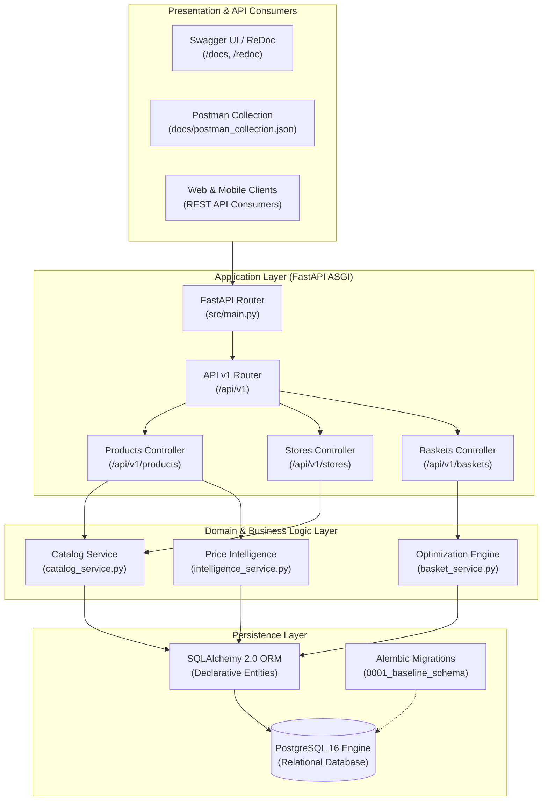
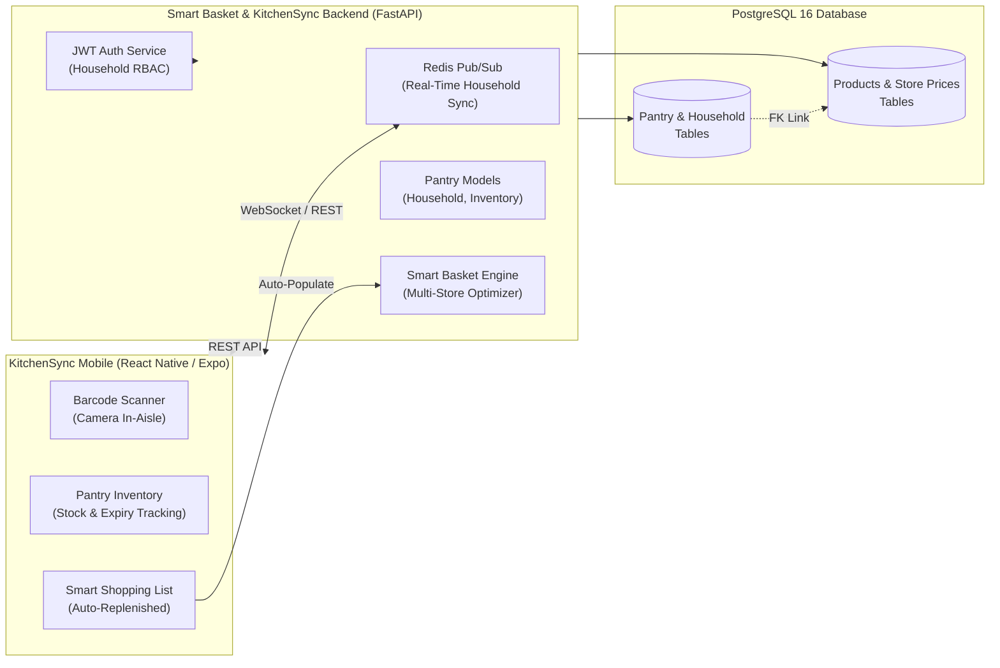

# Smart Basket 🛒

> Real-time grocery price intelligence and basket optimization engine featuring multi-store comparison, price tracking, and intelligent split shopping.

[](https://github.com/DyanCoded/Smart-Basket/actions/workflows/ci.yml)
[](https://www.python.org/downloads/)
[](https://fastapi.tiangolo.com)
[](https://www.postgresql.org/)
[](docs/RELEASE_NOTES_v1.0.0.md)
[](https://opensource.org/licenses/MIT)

---

## 📌 Project Overview

**Smart Basket** is a data-driven platform designed to eliminate the manual effort of hunting across multiple supermarket chains for the best grocery prices. By tracking catalog metadata, price changes over time, and store inventory, the Smart Basket engine calculates the most cost-effective shopping strategy—whether buying everything from a single store or intelligently splitting the basket across multiple retailers.

---

## 🏗️ System Architecture

The platform follows a layered, modular architecture separating presentation, business logic, and persistence:



Interactive API documentation and schema specifications are accessible via:
- **Interactive Swagger UI:** [http://localhost:8000/docs](http://localhost:8000/docs) (alias: [/api/docs](http://localhost:8000/api/docs))
- **OpenAPI 3.1.0 Specification:** [`docs/openapi.json`](docs/openapi.json) (or [/openapi.json](http://localhost:8000/openapi.json))

---

## 🚀 Getting Started

### Prerequisites
- **Git**
- **Python 3.11+**
- **Docker & Docker Compose** (for PostgreSQL 16)

### Complete Quick-Start Setup

1. **Clone the repository:**
   ```bash
   git clone https://github.com/DyanCoded/Smart-Basket.git
   cd Smart-Basket
   ```

2. **Set up virtual environment & install dependencies:**
   ```bash
   python -m venv .venv

   # Activate virtual environment:
   # On Windows:
   .venv\Scripts\activate
   # On Linux/macOS:
   source .venv/bin/activate

   # Install development and testing dependencies:
   pip install -r requirements-dev.txt
   ```

3. **Configure environment variables:**
   ```bash
   cp .env.example .env
   ```

4. **Start local PostgreSQL 16 database container:**
   ```bash
   docker-compose up -d
   # Or using Docker compose plugin:
   # docker compose up -d
   ```

5. **Apply database migrations & seed catalog fixtures:**
   ```bash
   alembic upgrade head
   python scripts/seed.py
   # Or run with divergence verification:
   # python scripts/seed.py --verify
   ```

6. **Run test suite & verification checks:**
   ```bash
   # Run Pytest test suite directly:
   pytest

   # Or execute the complete automated verification suite (Ruff, Black, Pytest):
   python scripts/check.py
   ```

7. **Start the development API server:**
   ```bash
   uvicorn src.main:app --reload --host 0.0.0.0 --port 8000
   ```
   Explore the interactive API docs directly in your browser at [http://localhost:8000/docs](http://localhost:8000/docs) and inspect the exportable OpenAPI specification at [`docs/openapi.json`](docs/openapi.json).

---

## 🎯 Core Features & User Journeys

### 1. Catalog Search & Discovery (Journey 1)
- Search universal grocery items across categories, brands, and standard packaging sizes (e.g. 2L, 500g, 1kg).
- Barcode/EAN-13 lookups and normalized unit pricing ($Price / Unit$).

### 2. Multi-Store Price Comparison & Basket Optimization (Journey 2)
- **Single-Store Ranking:** Calculates total basket cost per retailer to identify the cheapest single location.
- **Smart Mode (2-Store Split):** Evaluates multi-store splits where buying staple items at two different stores yields lower total costs than any single store.
- **Missing Item Handling:** Alerts users if a specific store branch lacks an item in their basket, reporting partial subtotals and missing item lists.
- **Exact Decimal Math:** All financial calculations utilize standard `Decimal` arithmetic to guarantee zero floating-point calculation error.

### 3. Price History Tracking & Intelligence (Journey 3)
- **Chronological Timeseries:** Query historical price movements over configurable windows (30d, 90d, 1y).
- **Trend Metrics:** Compute all-time high/low, store averages, and inflation trend direction (`INCREASING`, `DECREASING`, `STABLE`).
- **Discount Veracity Score:** 0–100 rating identifying whether an active promotion is a genuine deal (`GENUINE_SAVINGS`) or a cosmetic discount (`ARTIFICIAL_DISCOUNT`).

---

## ⚖️ Phase 1 Retrospective & Technical Trade-offs

During Phase 1, our primary focus was building a rigorous, mathematically exact price comparison and multi-store basket optimization engine. Key architectural choices and design trade-offs include:

1. **Chain-Level Price Tracking without Branch Inventory Overhead:**
   - **Decision:** Price tracking was modeled across 5 major national supermarket chains—**Checkers**, **Woolworths Food**, **Pick n Pay**, **SPAR**, and **Shoprite**—with branch-level representations.
   - **Trade-off:** Rather than maintaining real-time per-shelf SKU inventory counters across thousands of individual physical stores (which introduces heavy data churn, high volatility, and fragile external store API dependencies), pricing is tracked at the chain and regional branch level. This allowed us to focus squarely on price divergence algorithms, historical inflation tracking, and optimization logic while keeping API response times sub-15ms.

2. **Relational Integrity (PostgreSQL 16) vs Document Stores:**
   - Relational schemas with strict foreign keys (`StorePrice` ↔ `Product` ↔ `Store`) and unique constraints (`(store_id, product_id)`) guarantee zero duplicate prices and prevent referential corruption.
   - Exact precision with PostgreSQL `NUMERIC(10, 2)` and Python `Decimal` eliminated IEEE 754 floating-point drift across subtotals, promotional discounts, and split savings.

3. **Deterministic UUIDv5 Fixtures:**
   - Seed fixtures and test data use fixed-namespace UUIDv5 identifiers, enabling documentation examples, test assertions, and Postman collections to share identical deterministic IDs.

4. **In-Memory Optimization Engine:**
   - Bounded 2-store split optimization runs in $O(B \cdot S)$ time, executing basket calculations for 20+ items in $< 15\text{ ms}$ without needing external combinatorial solver daemons.

For the comprehensive technical evaluation, indexing analysis, and academic decision records, refer to the [Academic Retrospective](docs/RETROSPECTIVE.md) and [Architectural Decision Records](docs/DECISIONS.md).

---

## 🔮 Phase 2 Roadmap: KitchenSync Integration

In Phase 2, Smart Basket will expand from a standalone price comparison engine into a complete household grocery ecosystem through the integration of **KitchenSync**—a household pantry synchronization engine and **React Native (Expo)** mobile application.



### Key Phase 2 Capabilities:
1. **Household & Pantry Domain Porting:**
   - Port KitchenSync's household and pantry data models into our FastAPI / PostgreSQL stack, supporting multi-user household groups with role-based access control.
2. **JWT Authentication & Security:**
   - Implement JWT-based user authentication and household invitation codes for secure family pantry sharing.
3. **Real-Time Sync with Redis Pub/Sub:**
   - Deploy Redis Pub/Sub and WebSockets so pantry updates (e.g., an item marked consumed or added) sync instantly across all household members' devices.
4. **Pantry-to-SmartBasket Replenishment Bridge:**
   - Direct foreign key linkage between KitchenSync pantry items and SmartBasket's `products` and `baskets` tables.
   - When a pantry item falls below a user-defined threshold, it **automatically populates** the household's Smart Basket shopping list.
   - Shoppers can instantly compare the optimal store or 2-store split for their weekly auto-replenished basket before leaving home.
5. **Cross-Platform React Native (Expo) Mobile App:**
   - In-store camera barcode scanning to log pantry additions and perform instant aisle price checks across competing retailers.

---

## 📋 Project Status & Milestone Backlog

This project is engineered iteratively following a structured backlog pipeline:

| Phase | Milestone / Issue | Status | Reference |
| :--- | :--- | :---: | :--- |
| **01. Discovery** | `[Spec]` Core User Journeys & Smart Basket Requirements | 🟢 Completed | [#1](https://github.com/DyanCoded/Smart-Basket/issues/1) · [`SPECIFICATION.md`](docs/SPECIFICATION.md) |
| **02. Design** | `[Data]` Conceptual Domain Model & Entity Relationships | 🟢 Completed | [#2](https://github.com/DyanCoded/Smart-Basket/issues/2) · [`domain-model.md`](docs/domain-model.md) |
| **03. Architecture**| `[Arch]` Tech Stack Selection & Database Evaluation | 🟢 Completed | [#3](https://github.com/DyanCoded/Smart-Basket/issues/3) · [`DECISIONS.md`](docs/DECISIONS.md) |
| **04. Tooling** | `[Setup]` Scaffolding, Directory Layout & Local Env | 🟢 Completed | [#4](https://github.com/DyanCoded/Smart-Basket/issues/4) · [`pyproject.toml`](pyproject.toml) |
| **05. Data Layer** | `[Data]` Physical Database Schema & Baseline Migrations | 🟢 Completed | [#5](https://github.com/DyanCoded/Smart-Basket/issues/5) · [`alembic/`](alembic/) |
| **06. Testing Data**| `[Data]` Catalog Seeding Script & Test Data Fixtures | 🟢 Completed | [#6](https://github.com/DyanCoded/Smart-Basket/issues/6) · [`scripts/seed.py`](scripts/seed.py) |
| **07. Core API** | `[Backend]` Product Search & Store Pricing Endpoints | 🟢 Completed | [#7](https://github.com/DyanCoded/Smart-Basket/issues/7) · [`src/api/v1/`](src/api/v1/) |
| **08. Algorithms** | `[Backend]` Basket Calculation & Multi-Store Optimization | 🟢 Completed | [#8](https://github.com/DyanCoded/Smart-Basket/issues/8) · [`basket_service.py`](src/services/basket_service.py) |
| **09. Analytics** | `[Backend]` Price History Tracking & Intelligence APIs | 🟢 Completed | [#9](https://github.com/DyanCoded/Smart-Basket/issues/9) · [`intelligence_service.py`](src/services/intelligence_service.py) |
| **10. DevOps** | `[CI/CD]` GitHub Actions Pipeline for Linting & Tests | 🟢 Completed | [#10](https://github.com/DyanCoded/Smart-Basket/issues/10) · [`.github/workflows/ci.yml`](.github/workflows/ci.yml) |
| **11. Specs** | `[Docs]` OpenAPI / Swagger Specs & API Explorer | 🟢 Completed | [#11](https://github.com/DyanCoded/Smart-Basket/issues/11) · [`docs/openapi.json`](docs/openapi.json) |
| **12. Delivery** | `[Release]` Final Packaging, Documentation & Review | 🟢 Completed | [#12](https://github.com/DyanCoded/Smart-Basket/issues/12) · [`RELEASE_NOTES_v1.0.0.md`](docs/RELEASE_NOTES_v1.0.0.md) |
| **13. Architecture** | `[Arch]` KitchenSync Pantry Integration & Unified Schema ADR | 🟢 Completed | [#13](https://github.com/DyanCoded/Smart-Basket/issues/13) · [`DECISIONS.md`](docs/DECISIONS.md) |
| **14. Data Layer** | `[Data]` Physical Database Schema & Migration for Pantry & Households | 🟢 Completed | [#14](https://github.com/DyanCoded/Smart-Basket/issues/14) · [`migrations/`](migrations/) |
| **15. Auth & Access** | `[Backend]` JWT Auth & Household Membership Endpoints | 🟢 Completed | [#15](https://github.com/DyanCoded/Smart-Basket/issues/15) · [`src/api/v1/auth.py`](src/api/v1/auth.py) |
| **16. Pantry Sync** | `[Backend]` Implement pantry CRUD, offline delta-sync & auto-basket bridge | 🟢 Completed | [#16](https://github.com/DyanCoded/Smart-Basket/issues/16) · [`src/api/v1/pantry.py`](src/api/v1/pantry.py) |

---

## 💻 Sample API Usage

### 1. Catalog Search
```bash
curl -s "http://localhost:8000/api/v1/products?q=milk&limit=5" | jq .
```

### 2. Multi-Store Basket Calculation (Single-Store Ranking & Smart Split)
```bash
curl -X POST "http://localhost:8000/api/v1/baskets/calculate" \
  -H "Content-Type: application/json" \
  -d '{
    "items": [
      {
        "product_id": "6e2941e3-033d-5768-8143-5e7ebc24b874",
        "quantity": 2.0
      },
      {
        "product_id": "ab9928f5-221a-5546-8b6c-c4ec04fbe933",
        "quantity": 1.0
      }
    ]
  }' | jq .
```

### 3. Price Trend Intelligence & Deal Veracity
```bash
curl -s "http://localhost:8000/api/v1/products/6e2941e3-033d-5768-8143-5e7ebc24b874/intelligence" | jq .
```

---

## 📖 API Documentation & Client Collections

Smart Basket features native OpenAPI 3.1.0 specifications and interactive documentation:

### Interactive Documentation UIs
- **Swagger UI:** [http://localhost:8000/docs](http://localhost:8000/docs) (alias: [/api/docs](http://localhost:8000/api/docs))
- **ReDoc UI:** [http://localhost:8000/redoc](http://localhost:8000/redoc) (alias: [/api/redoc](http://localhost:8000/api/redoc))

### Exported Artifacts
- **OpenAPI 3.1.0 JSON Spec:** [`docs/openapi.json`](docs/openapi.json) (live endpoint: `/openapi.json`)
- **OpenAPI 3.1.0 YAML Spec:** [`docs/openapi.yaml`](docs/openapi.yaml) (live endpoint: `/openapi.yaml`)
- **Postman Collection v2.1.0:** [`docs/postman_collection.json`](docs/postman_collection.json) — Importable into Postman or Insomnia.

### Regenerating Documentation Artifacts
Whenever routes, Pydantic schemas, or examples are modified:
```bash
python scripts/export_openapi.py
```

### API Endpoints Summary

| Method | Endpoint | Description |
| :--- | :--- | :--- |
| `GET` | `/health` | Service liveness and operational readiness check |
| `GET` | `/api/v1/products` | Search catalog by partial name, brand, barcode, or category |
| `GET` | `/api/v1/products/{id}` | Detailed product metadata including packaging unit size |
| `GET` | `/api/v1/products/{id}/prices` | Active prices and stock status across monitored stores |
| `GET` | `/api/v1/products/{id}/history` | Chronological price timeseries points for charting |
| `GET` | `/api/v1/products/{id}/intelligence` | Trend analytics, inflation metrics, and deal veracity score |
| `GET` | `/api/v1/stores` | Supermarket chains, retailer brands, and branch locations |
| `POST`| `/api/v1/baskets/calculate` | Single-store totals and Smart Mode multi-store split optimization |
| `POST`| `/api/v1/auth/register` | Register a new user account with unique email and password |
| `POST`| `/api/v1/auth/login` | Authenticate user and receive signed JWT access token |
| `GET` | `/api/v1/auth/me` | Retrieve current user profile and active household memberships |
| `GET` | `/api/v1/homes` | List all households the authenticated user belongs to |
| `POST`| `/api/v1/homes` | Create a new household and auto-assign creator as buyer |
| `GET` | `/api/v1/homes/{id}` | Household details and full member roster (buyer/consumer) |
| `POST`| `/api/v1/homes/{id}/members` | Invite and add a member with buyer or consumer role |
| `DELETE`| `/api/v1/homes/{id}/members/{user_id}` | Remove a member from the household |
| `GET` | `/api/v1/homes/{home_id}/pantry` | List household pantry inventory with category & stock status filters |
| `POST`| `/api/v1/homes/{home_id}/pantry` | Create a new catalogued or custom pantry item with quantity |
| `GET` | `/api/v1/homes/{home_id}/pantry/{item_id}` | Retrieve detailed pantry item and consumption audit log |
| `PATCH`| `/api/v1/homes/{home_id}/pantry/{item_id}` | Update pantry item quantity/status (auto-bridges to basket when low/finished) |
| `DELETE`| `/api/v1/homes/{home_id}/pantry/{item_id}` | Soft-delete a pantry item with tombstone record |
| `POST`| `/api/v1/homes/{home_id}/pantry/sync` | Offline delta sync: reconcile client mutations with LWW and return deltas |
| `GET` | `/api/v1/homes/{home_id}/pantry/basket` | View the household's active auto-replenished Smart Basket |

---

## 🎓 Academic Documentation & Retrospective

For academic review, architecture justifications, and grading artifacts:
- **[Academic Retrospective & Technical Evaluation](docs/RETROSPECTIVE.md):** In-depth discussion of domain modeling, combinatorial complexity, indexing strategy, benchmarks, trade-offs, and Phase 2 roadmap.
- **[Architectural Decision Records (ADR)](docs/DECISIONS.md):** Documented architectural choices and trade-offs.
- **[Domain Model Specification](docs/domain-model.md):** Conceptual domain entities and normalization rules.
- **[User Journeys Specification](docs/SPECIFICATION.md):** Core personas and user workflows.
- **[Release Notes v1.0.0](docs/RELEASE_NOTES_v1.0.0.md):** Final Phase 1 milestone deliverables and changelog.

---

## 📄 License
This project is open-source under the [MIT License](LICENSE).
