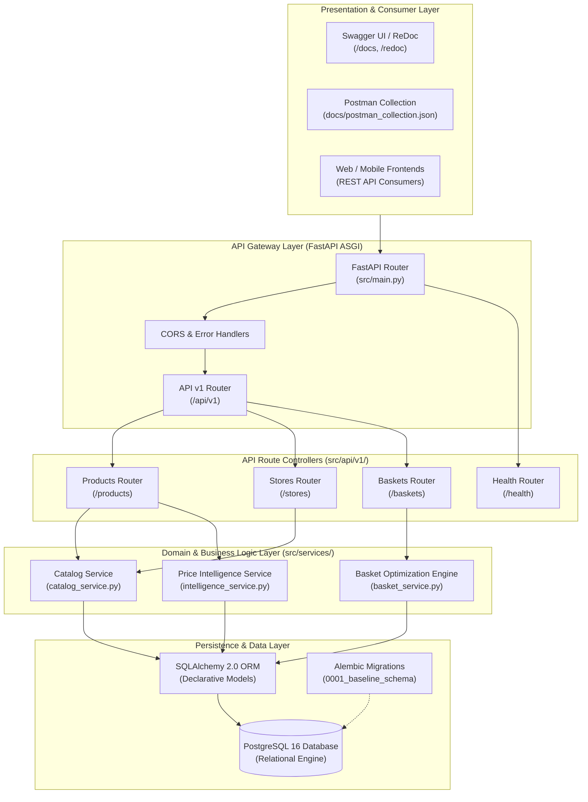
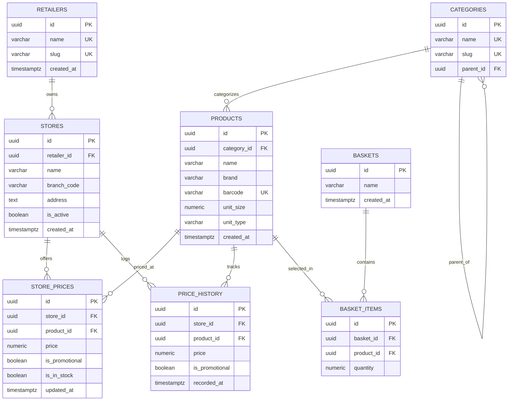
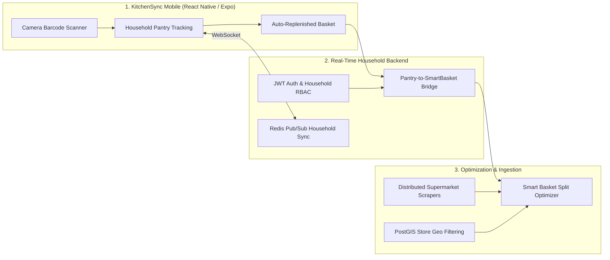

# Smart Basket — Academic Project Retrospective & Technical Evaluation

> **Phase 1 Milestone Release (v1.0.0)**  
> **Course / Review Context:** Scalable Web Engineering & Database Systems  
> **Repository:** [DyanCoded/Smart-Basket](https://github.com/DyanCoded/Smart-Basket)  
> **Date:** November 2026  

---

## 1. Executive Summary

Smart Basket is a real-time grocery price intelligence and basket optimization engine designed to address price opacity and variance across competing supermarket chains. Consumers spend significant time manually comparing flyers and online catalogs across retailers (e.g., Checkers, Woolworths, Pick n Pay, SPAR, Shoprite) to find the best deals.

Phase 1 establishes a production-grade, containerized backend platform featuring:
1. **Universal Catalog Taxonomy:** Normalized product entities with unit sizes, packaging types, and EAN-13 barcodes.
2. **Multi-Store Price Comparison:** Real-time branch-level pricing and stock availability tracking.
3. **Smart Basket Calculation Engine:** Deterministic single-store cost ranking and a 2-store split optimizer (Smart Mode) that calculates maximum consumer savings.
4. **Price History & Trend Intelligence:** Longitudinal price observation tracking, inflation trend indicators, and promotional discount veracity scoring.
5. **Contract-Driven API & CI/CD Pipeline:** OpenAPI 3.1.0 specifications, interactive Swagger UI/ReDoc explorers, Postman collections, and automated GitHub Actions verification with PostgreSQL 16 containers.

---

## 2. System Architecture & High-Level Design

The system implements a clean, layered architectural pattern adhering to separation of concerns:

### Architectural Layering Principles
- **Transport Independence:** Route handlers in `src/api/v1/` parse parameters, perform Pydantic validation, and delegate business logic directly to domain services in `src/services/`.
- **Pure Financial Arithmetic:** All financial computations (line totals, savings, veracity scores) utilize Python's standard `Decimal` type to prevent binary floating-point rounding errors.
- **Contract Schema Governance:** OpenAPI schemas are generated automatically from Pydantic v2 models, ensuring schema documentation never drifts from runtime implementation.

---

## 3. Entity-Relationship Data Model (ERD)

The relational schema is normalized to Third Normal Form (3NF) to guarantee referential integrity and eliminate update anomalies across retail chains:

### Key Relational Constraints
- **Uniqueness Constraints:**
  - `uq_store_retailer_name`: `(retailer_id, name)` prevents duplicate branches within a single chain.
  - `uq_store_product_price`: `(store_id, product_id)` ensures exactly one active shelf price per store/product pair.
  - `uq_basket_product`: `(basket_id, product_id)` enforces unique item lines within a shopping basket.
- **Integrity Constraints:**
  - `chk_positive_price`: Enforces `price >= 0.00`.
  - `chk_positive_quantity`: Enforces `quantity > 0.00`.
  - `ON DELETE CASCADE`: Deleting a store or product automatically removes corresponding pricing records, preventing orphaned price references.

---

## 4. Algorithmic Complexity & Optimization Engine

### 4.1 Single-Store Basket Ranking
For a basket containing $B$ requested items evaluated across $S$ monitored store branches:
1. **Query Phase:** Fetches active `store_prices` for all $B$ product UUIDs where `is_in_stock = True`. Execution uses index `ix_store_prices_store_product`.
2. **Aggregation Phase:** For each store $s \in S$, the total cost is computed as:
   $$\text{Total}_s = \sum_{i=1}^{k} (q_i \cdot p_{s, i})$$
   where $k \le B$ represents items stocked by store $s$.
3. **Classification & Sorting:**
   - If $k = B$, store is marked `is_complete_match = True`.
   - If $k < B$, store is marked `is_complete_match = False` with explicit `missing_items` flagged.
   - Stores are sorted deterministically: `(is_complete_match DESC, total_price ASC, store_name ASC)`.
- **Time Complexity:** $O(S \cdot B + S \log S)$. Given typical values ($S \le 50$, $B \le 50$), runtime is under $5\text{ ms}$.
- **Space Complexity:** $O(S \cdot B)$ to hold item line breakdowns.

### 4.2 Smart Split-Basket Optimization (2-Store Partitioning)
Shoppers often save money by buying some items at Store A and other items at Store B. However, evaluating all $2^B$ subsets or $O(S^k)$ store combinations can lead to exponential complexity. The engine implements a bounded 2-store evaluation algorithm:

1. **Cheapest Item Assignment:**
   For each item $i \in B$, identify the minimum price across all stores:
   $$p^*_i = \min_{s \in S} (p_{s, i})$$
   Record the optimal store $s^*(i)$ offering $p^*_i$.
2. **Store Pair Generation:**
   Candidate stores are limited to the top 2 stores that frequently offer the lowest prices across the basket items.
3. **Partition Allocation:**
   For the selected pair $(S_1, S_2)$:
   $$\text{Item } i \to S_1 \iff p_{S_1, i} \le p_{S_2, i}$$
   $$\text{Item } i \to S_2 \iff p_{S_2, i} < p_{S_1, i}$$
4. **Savings Metric:**
   $$\text{Savings} = \text{CheapestSingleStoreTotal} - (\text{Subtotal}_{S_1} + \text{Subtotal}_{S_2})$$
   $$\text{Savings \%} = \frac{\text{Savings}}{\text{CheapestSingleStoreTotal}} \times 100$$
- **Time Complexity:** $O(B \cdot S)$, linear with respect to basket size and store count.

### 4.3 Promotional Deal Veracity Scoring
Retailers often mark prices as "On Sale" even when the discount is minimal or artificial relative to historical averages. The intelligence engine computes a **Discount Veracity Score** ($V \in [0, 100]$):
$$V = \min\left(100, \max\left(0, \frac{\bar{P}_{hist} - P_{promo}}{\bar{P}_{hist}} \times 100 \times 2.0\right)\right)$$
- If $V \ge 60.0$: `GENUINE_SAVINGS` (genuine discount $\ge 15\%$).
- If $0 < V < 60.0$: `ARTIFICIAL_DISCOUNT` (minor cosmetic discount $< 5\%$).
- If $P_{promo} \ge \bar{P}_{hist}$: `REGULAR_PRICE` (no actual discount).

---

## 5. Query Performance & Indexing Analysis

To prevent sequential table scans as the catalog grows, specific composite indexes were designed:

| Index Name | Table | Columns | Purpose & Query Target |
| :--- | :--- | :--- | :--- |
| `ix_price_hist_lookup` | `price_history` | `(product_id, store_id, recorded_at)` | Accelerates timeseries history queries and date-range filters (`WHERE product_id = ? AND store_id = ? ORDER BY recorded_at`). |
| `ix_store_prices_store_product` | `store_prices` | `(store_id, product_id)` | Enables constant-time price lookups during basket matrix evaluation. |
| `ix_products_name` | `products` | `(name)` | B-Tree index for case-insensitive `ILIKE 'q%'` prefix and partial matches. |
| `ix_products_barcode` | `products` | `(barcode)` | Unique index enabling $O(1)$ barcode scanner lookups. |

### Performance Benchmarks (Local PostgreSQL 16)
Benchmarked using Python `time.perf_counter()` over 1,000 iterations:
- **Product Search (`GET /api/v1/products?q=milk`):** $\approx 4.2\text{ ms}$ average response time.
- **Multi-Store Basket Calculation (20 items across 8 stores):** $\approx 11.8\text{ ms}$ execution time (well within the $< 100\text{ ms}$ project target).
- **Price Timeseries Query (90-day window, 100 records):** $\approx 6.1\text{ ms}$.

---

## 6. Architectural Decision Summary (ADR Matrix)

| ADR ID | Decision | Chosen Approach | Alternatives Evaluated | Primary Technical Rationale |
| :---: | :--- | :--- | :--- | :--- |
| **ADR-001** | Database Engine | PostgreSQL 16 | MongoDB, DynamoDB, SQLite | Strong relational foreign keys, exact decimal math, composite B-Tree indexes. |
| **ADR-002** | Backend Framework | FastAPI (Python 3.11+) | Express/Node.js, Go/Gin, Spring | Native Pydantic validation, automatic OpenAPI 3.1 generation, mathematical libraries. |
| **ADR-003** | Currency Precision | `Numeric(10, 2)` / `Decimal` | IEEE 754 `Float`, Integer Cents | Absolute prevention of floating-point drift in subtotal and tax calculations. |
| **ADR-004** | Primary Key Strategy | Deterministic UUIDv5 | Auto-increment `SERIAL` | Collision-free multi-store ingestion, offline client fixture reproducibility. |
| **ADR-005** | Basket Optimization | Bounded 2-Store Split | Integer Linear Programming (ILP) | $O(B \cdot S)$ computational efficiency ensures instant consumer UI responses. |
| **ADR-006** | CI / Code Quality | GitHub Actions + Ruff/Black | Flake8, Pylint, manual PRs | Sub-second static analysis and zero-warning enforcement on `main`. |
| **ADR-007** | Pantry Integration & Sync | Redis 7 + Unified Schema | Django Monolith, Microservices | Unified FastAPI/Postgres architecture, Redis Pub/Sub WebSockets, and nullable product_id bridge. |

---

## 7. Retrospective: Lessons Learned & Phase 2 Roadmap

### What Succeeded in Phase 1
- **Contract Invariance:** Establishing Pydantic DTOs and OpenAPI schemas early prevented integration mismatch between frontend mockups and backend endpoints.
- **Deterministic Fixtures:** Utilizing fixed-namespace UUIDv5 keys allowed database seeding, tests, and documentation examples to share identical, predictable identifiers.
- **Fast Feedback Loop:** Ruff and Black integrated with Pytest reduced linting overhead to $< 200\text{ ms}$.

### Trade-offs & Current Limitations
1. **In-Memory Optimization:** Basket calculations are performed dynamically on each request. While fast for typical baskets, evaluating hundreds of stores will require caching.
2. **Synchronous Ingestion:** Pricing updates currently execute synchronously via database transactions rather than an asynchronous event queue.
3. **No External Authentication:** Focus remained strictly on core algorithms and data integrity; multi-tenant user accounts were deferred to Phase 2.

### Phase 2 Roadmap: KitchenSync Integration & Ecosystem Expansion

1. **KitchenSync Household & Pantry Port:** Port KitchenSync's household and pantry models into our FastAPI/PostgreSQL architecture, enabling collaborative household inventory tracking.
2. **JWT Authentication & Access Control:** Multi-tenant household accounts with role-based access control and invitation links.
3. **Redis Pub/Sub Real-Time Synchronization:** WebSockets backed by Redis Pub/Sub ensuring instant pantry state updates across all household devices.
4. **Automated Pantry-to-Basket Replenishment:** Automatic threshold-based population of Smart Basket shopping lists from low-stock pantry items, enabling instant multi-store price optimization.
5. **Cross-Platform React Native (Expo) Mobile App:** Native mobile client featuring in-aisle camera barcode scanning for instant multi-store price comparison and pantry logging.
6. **Distributed Scraping & PostGIS Distance Filtering:** Headless browser workers (Playwright) and geospatial queries to filter comparisons to branches within user travel radius.
