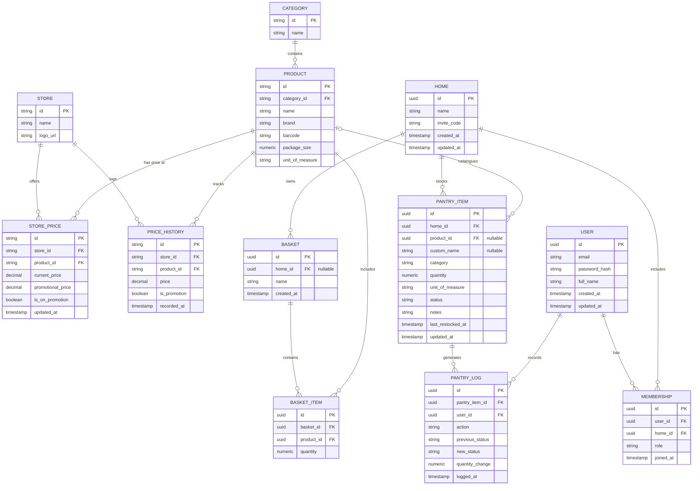

# Smart Basket — Conceptual Domain Model & Entity Relationships

This document outlines the core domain entities, data attributes, integrity rules, and relationships for the Smart Basket platform.

---

## 1. Simplified Conceptual Entities

### 1. Store (Supermarket Chain)
Represents the brand/chain being compared.
- **Attributes:**
  - `id`: Unique identifier (UUID)
  - `name`: Store/brand name (e.g., *Checkers*, *Pick n Pay*, *Woolworths*, *SPAR*, *Shoprite*)
  - `logo_url`: URL path to store logo
- **Purpose:** The single source of pricing for that brand.

### 2. Category
Organizes products into high-level groupings.
- **Attributes:**
  - `id`: Unique identifier (UUID)
  - `name`: Category label (e.g., *Dairy*, *Bakery*, *Pantry*, *Produce*)

### 3. Product (Universal Item)
Represents the physical grocery item regardless of where it is sold.
- **Attributes:**
  - `id`: Unique identifier (UUID)
  - `category_id`: Foreign key reference to Category
  - `name`: Product title (e.g., *"Full Cream Fresh Milk"*)
  - `brand`: Brand name (e.g., *"Clover"*)
  - `barcode`: Universal product code / EAN-13 barcode, where available
  - `package_size`: Numeric quantity (e.g., `2`)
  - `unit_of_measure`: Base measurement unit (e.g., `L`, `kg`, `g`, `ml`, `unit`)

### 4. StorePrice (Current Chain Price)
Links a specific universal product to a store chain and records its active price.
- **Attributes:**
  - `id`: Unique identifier (UUID)
  - `store_id`: Foreign key reference to Store
  - `product_id`: Foreign key reference to Product
  - `current_price`: Decimal / numeric active selling price
  - `promotional_price`: Nullable decimal / numeric discount price
  - `is_on_promotion`: Boolean flag indicating promotion status
  - `updated_at`: Timestamp of latest price sync
- **Rule:** A unique constraint on `(store_id, product_id)` ensures each store chain maintains exactly one active price record per product.

### 5. PriceHistory (Time-Series Log)
Records historical price movements for tracking trends across chains over time.
- **Attributes:**
  - `id`: Unique identifier (UUID)
  - `store_id`: Foreign key reference to Store
  - `product_id`: Foreign key reference to Product
  - `price`: Decimal / numeric recorded price point
  - `is_promotion`: Boolean flag indicating if price was promotional
  - `recorded_at`: Timestamp of price observation

### 6. Basket & BasketItem (User List)
Enables shoppers and households to build custom grocery baskets for multi-store evaluation.
- **Basket Attributes:**
  - `id`: Unique identifier (UUID)
  - `home_id`: Nullable foreign key reference to Home (associates basket with a household)
  - `name`: User-facing basket name (e.g., *"Weekly Shop"*)
  - `created_at`: Creation timestamp
- **BasketItem Attributes:**
  - `id`: Unique identifier (UUID)
  - `basket_id`: Foreign key reference to Basket
  - `product_id`: Foreign key reference to Product
  - `quantity`: Numeric quantity required

### 7. User (Account & Authentication)
Represents an authenticated shopper or household resident.
- **Attributes:**
  - `id`: Unique identifier (UUID)
  - `email`: Unique email address for login
  - `password_hash`: Cryptographic password hash (bcrypt / argon2)
  - `full_name`: User display name
  - `created_at`: Account creation timestamp
  - `updated_at`: Account modification timestamp

### 8. Home (Household Living Space)
Represents a shared living space, family unit, or shared apartment.
- **Attributes:**
  - `id`: Unique identifier (UUID)
  - `name`: Household name (e.g., *"Main Residence"*, *"Beach Cottage"*)
  - `invite_code`: Unique short alphanumeric code for inviting family members
  - `created_at`: Household creation timestamp
  - `updated_at`: Household modification timestamp

### 9. Membership (User-Home Link & RBAC)
Links a user to one or more homes, defining their role and permissions.
- **Attributes:**
  - `id`: Unique identifier (UUID)
  - `user_id`: Foreign key reference to User
  - `home_id`: Foreign key reference to Home
  - `role`: Role string (`buyer` or `consumer`)
  - `joined_at`: Membership join timestamp
- **Rules:**
  - A unique constraint on `(user_id, home_id)` ensures a user holds at most one role per home.
  - **Role Capabilities:**
    - `buyer`: Primary shopper authority. Can add, edit, or delete pantry items, trigger multi-store basket optimizations, and check off items during in-store shopping.
    - `consumer`: Household resident authority. Can view pantry inventory and log item consumption (mark items `low` or `finished`).

### 10. PantryItem (Household Inventory & Bridge)
Represents a grocery item physically tracked in a household's pantry or refrigerator.
- **Attributes:**
  - `id`: Unique identifier (UUID)
  - `home_id`: Foreign key reference to Home
  - `product_id`: Nullable foreign key reference to Product (catalog replenishment bridge)
  - `custom_name`: Nullable string for uncatalogued or custom grocery items
  - `category`: Classification label (e.g., *Dairy*, *Produce*, *Spices*)
  - `quantity`: Current numeric stock quantity
  - `unit_of_measure`: Base measurement unit (e.g., `units`, `kg`, `L`)
  - `status`: Stock status (`available`, `low`, `finished`)
  - `notes`: Optional user notes or packaging instructions
  - `last_restocked_at`: Timestamp of latest restock event
  - `updated_at`: Timestamp of latest status change
- **Replenishment Bridge Rules:**
  - **Catalog Items (`product_id IS NOT NULL`):** Mapped to a universal catalog product. When marked `low` or `finished`, the item auto-replenishes into the household's active basket (`basket_items`) for multi-store price comparison and split optimization.
  - **Custom Items (`product_id IS NULL`):** Supported via `custom_name` without failing catalog referential constraints.

### 11. PantryLog (Consumption & Audit Trail)
Maintains an immutable historical record of inventory actions, consumption events, and restocking.
- **Attributes:**
  - `id`: Unique identifier (UUID)
  - `pantry_item_id`: Foreign key reference to PantryItem
  - `user_id`: Foreign key reference to User (who initiated the action)
  - `action`: Event type (`status_changed`, `item_added`, `item_consumed`, `item_restocked`)
  - `previous_status`: Nullable string representing previous status
  - `new_status`: Nullable string representing new status
  - `quantity_change`: Nullable numeric change in quantity
  - `logged_at`: Event timestamp

---

## 2. Streamlined Entity Relationships

| From Entity | Relationship | To Entity | Description |
| :--- | :---: | :--- | :--- |
| **Category** | `1 : N` | **Product** | One category contains many products. |
| **Product** | `1 : N` | **StorePrice** | One product has a price entry at each store chain. |
| **Store** | `1 : N` | **StorePrice** | One store chain lists current prices for many products. |
| **Store / Product** | `1 : N` | **PriceHistory** | Tracks price shifts for that product at that store over time. |
| **Basket** | `1 : N` | **BasketItem** | A user basket contains multiple products and quantities. |
| **Home** | `1 : N` | **Basket** | A household owns shopping baskets for multi-store optimization. |
| **User** | `1 : N` | **Membership** | A user can be a member of multiple households. |
| **Home** | `1 : N` | **Membership** | A household contains multiple members with defined roles. |
| **Home** | `1 : N` | **PantryItem** | A household manages its own pantry and refrigerator inventory. |
| **Product** | `0..1 : N` | **PantryItem** | Universal products optionally link to pantry items (nullable bridge). |
| **PantryItem** | `1 : N` | **PantryLog** | Every pantry item records historical consumption and restock logs. |
| **User** | `1 : N` | **PantryLog** | A user generates logs when updating pantry stock or statuses. |

---

## 3. Entity Relationship Diagram (ERD)

